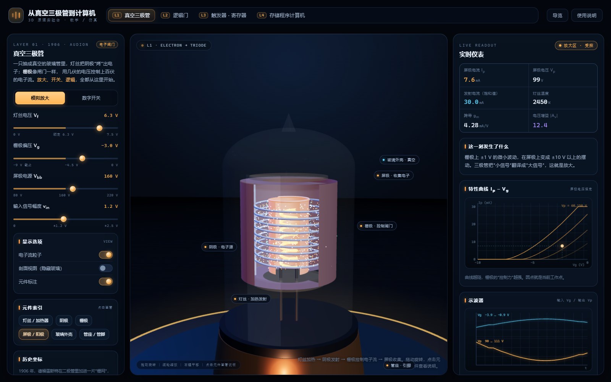
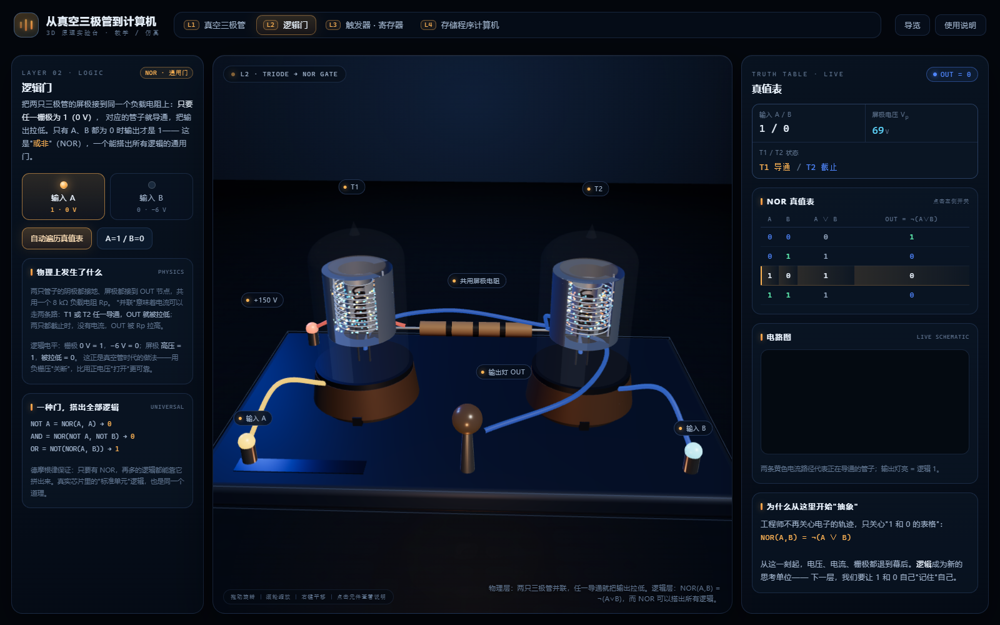
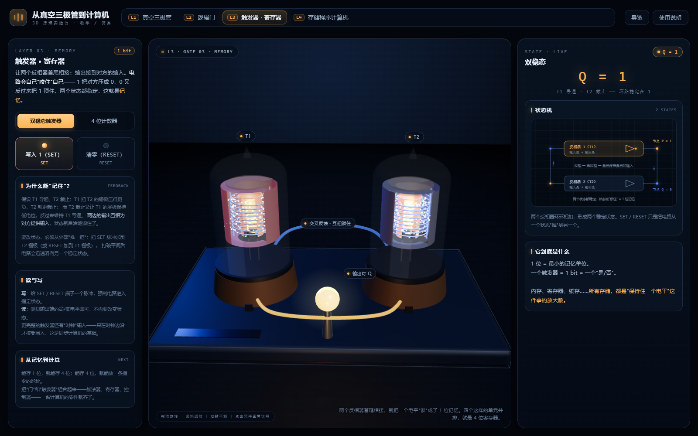
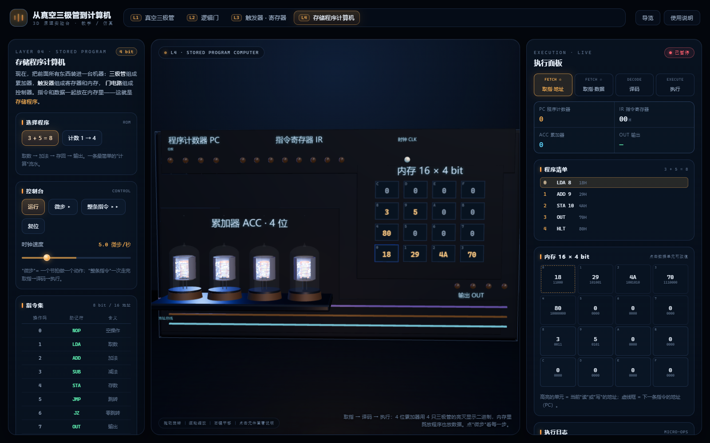

# 从真空三极管到计算机 · 3D 教学与仿真实验台
### 设计文档（v0.1 · 可运行原型）


---

## 0. 一页结论

**可以构建，而且第一版已经跑起来了。** 本项目是一个单文件、离线运行的 3D 交互模型，
用四层"可操作现场"讲清一台计算机是怎样从一只玻璃管里长出来的：

| 层 | 一句话 | 核心机制 |
| --- | --- | --- |
| L1 真空三极管 | 电子被栅极"闸住" | 热电子发射 + 空间电荷限制 + 屏极负载线 |
| L2 逻辑门 | 两管并联就是 NOR | 屏极并联、共负载电阻；NOR 的通用性 |
| L3 触发器 / 寄存器 | 电路自己记住自己 | 交叉耦合再生反馈、时钟、二进制进位 |
| L4 存储程序计算机 | 取指 → 译码 → 执行 | 4 位 CPU、16×4 bit 内存、总线与寄存器 |

判断依据：

- **技术可行**：three.js + Canvas 2D + 原生 JS 即可完成；无后端、无网络依赖，构建产物约 700 KB，一个 HTML 文件就能拷进教室。
- **教学可行**：每个抽象层都同时给出"物理现象 / 电路图 / 真值表 / 状态 / 日志"五种表征，同一状态在 3D 与 2D 间同步，符合"宏观—微观—符号"转换的教学需要。
- **仿真深度可选**：当前是"物理规律近似 + 逻辑精确"；如需真实电路级仿真，可接 ngspice-WASM（见 §8 路线图）。
- **主要成本不在 3D**，而在**内容设计**：把每一层的知识点压缩成"一个可操作的实验 + 一句结论"，以及课堂活动/练习题的设计。

已通过自动化验证：4 个场景、9 项交互检查全部通过，控制台零报错（`node tools/smoke.mjs`）。

---

## 1. 目标与边界

### 1.1 教学目标（三层）

1. **知识**：理解三极管放大/开关原理、逻辑门的物理来源、双稳态与时钟、存储程序结构。
2. **方法**：体验"抽象"——同一物理现象如何被逐层封装成符号（电压 → 比特 → 逻辑 → 指令）。
3. **情感**：看见 1940 年代工程师面对的体积、热量与故障率，理解技术演进的动因。

### 1.2 明确不做什么（当前版本）

- 不做真实 SPICE：未建模栅流、极间电容、密勒效应、温度漂移、噪声与寄生参数。
- 不做电子轨迹的物理精确积分：粒子是按"通过率 = Ip/Iemission"抽样的示意动画。
- 不做历史精确复刻：L4 的 ISA 是为教学设计的 4 位玩具指令集，不对应 ENIAC/IBM 604 等真实机型。
- 不做移动端专门适配（当前面向 1280px 以上桌面/投影）。

---

## 2. 用户与使用场景

| 场景 | 使用者 | 怎么用 |
| --- | --- | --- |
| 课堂演示（投影/大屏） | 教师 | 按 1–4 逐层讲，现场拖滑杆、点开关、单步运行 |
| 学生自主探索 | 学生 | 打开 HTML，按导览路径玩一遍；用"自动遍历/自动时钟/运行"观察动态 |
| 课后复习 | 学生 | 单文件发给学生，离线可用；每层右侧面板就是"随堂讲义" |
| 内容二次开发 | 开发者/教师 | 场景模块化，改文案、加场景、接课程包成本低 |

---

## 3. 教学地图（知识点 × 交互 × 表征）

### L1 真空三极管

- **知识点**：热电子发射；阴极/栅极/屏极的角色；栅极电压控制屏流；截止/放大/饱和；负载线；放大与反相；数字抽象（电压区间表示 0/1）。
- **可操作**：灯丝电压 `Vf` 0–7.5 V；栅极偏压 `Vg` −9–0 V；屏极电源 `Vbb` 80–220 V；输入幅度 `vin`；模拟放大 / 数字开关两种模式；自动翻转。
- **仪表**：屏流、屏压、饱和发射电流、阴极温度估算、跨导、电压增益；`Ip–Vg` 特性曲线（4 条 `Vp` 等值线 + 工作点）；双通道示波器（自动量程，输入/输出反相一目了然）。
- **3D 交互**：点击灯丝/阴极/栅极/屏极/玻璃/管座，查看部件说明；电子流粒子、剖面视图、元件标注开关。
- **结论句**：*栅极上几伏的电压，控制着屏极上百伏的电子流；这就是放大，也是开关。*



### L2 逻辑门（NOR）

- **知识点**：三极管反相器；并联 = 或非；逻辑电平约定；真值表；NOR 的通用性（NOT/AND/OR 的 NOR 构造）；从"电子"到"1/0"的抽象跳跃。
- **可操作**：A/B 两个电平开关；自动遍历真值表；查看"用一种门搭出全部逻辑"的公式与实时结果。
- **仪表**：真值表（当前行高亮）、A/B 电压与逻辑值、屏极电压、两管导通状态、2D 电路图（导通路径/输出灯实时同步）。
- **结论句**：*NOR 一个门就能搭出所有逻辑；从这一刻起，工程师只谈 1 和 0。*
- **物理↔逻辑的桥**：栅极 `0 V = 1`、`−6 V = 0`；屏极高压 = 1、被拉低 = 0。负栅压关断是电子管时代的自然做法。



### L3 触发器 · 寄存器

- **知识点**：再生反馈；双稳态；SET/RESET；时钟；4 位寄存器；二进制权重；行波进位与溢出。
- **可操作**：双稳态模式（SET/RESET，观察两管轮流导通）；计数器模式（手动时钟、自动时钟 0.4–4 Hz、复位）。
- **仪表**：状态机图（两个反相器成环，节点电平随状态变化）；4 位二进制显示与位灯；当前状态解释。
- **结论句**：*两个反相器首尾相接，就把一个电平"锁"成了 1 位记忆；四个这样的单元就是 4 位寄存器。*



### L4 存储程序计算机

- **知识点**：冯·诺依曼结构；取指—译码—执行；PC/IR/ACC/内存/总线；指令编码；循环与条件分支；机器码与汇编的对应。
- **可操作**：选择程序（3+5=8 / 计数 1→4）、微步、整条指令、运行/暂停、复位、时钟速度 1–20 微步/秒；数据单元可点击改值。
- **仪表**：4 阶段流水线高亮、寄存器、程序清单（当前指令）、16 单元内存网格（读/写/PC 高亮）、执行日志（每条微操作一句解释）、输出记录。
- **3D 联动**：4 只三极管 = 累加器 4 位（亮/灭即二进制）；PC/IR/OUT 位灯阵列；内存单元数值贴图；三条总线按阶段呼吸发光。
- **结论句**：*程序和数据放在同一块内存里，机器"读指令"而不是"被接线决定"——现代计算机的起点。*



---

## 4. 物理与逻辑模型

### 4.1 三极管模型（`src/lib/physics.js`）

采用两条工程上站得住的规律，兼顾可控与可解释：

1. **热电子发射（Richardson–Dushman 的简化）**
   灯丝电压 → 阴极温度与饱和发射电流：
   `I_em = I_max · (Vf / 6.3)^5.5`，`T ≈ 300 + 2150·(Vf/6.3)^0.85`。
   对温度/灯丝电压的强非线性（≈ 5.5 次方）让"灯丝没热透就没电子"这件事看得见。

2. **空间电荷限制（Child–Langmuir 的三极管形式）**
   `Ip = K · (Vg + Vp/μ)^1.5`，当 `Vg + Vp/μ ≤ 0` 时 `Ip = 0`（截止）；并受饱和发射 `I_em` 封顶。

参数（常见小功率三极管量级）：

| 参数 | 值 | 含义 |
| --- | --- | --- |
| μ | 20 | 放大系数 |
| K | 1.75×10⁻³ A/V^1.5 | 几何/结构因子 |
| I_max | 30 mA | 额定灯丝下的饱和发射 |
| Vbb | 160 V | 屏极电源 |
| Rp | 8 kΩ | 屏极负载电阻 |

**静态工作点**：联立 `Vp = Vbb − Ip·Rp` 与上式，用二分法求根（单调，40+ 次迭代）。
工作区判定：`Vg + Vp/μ ≤ 0` → 截止；`Vp < 28 V` → 饱和；否则放大。
**跨导** `gm = ∂Ip/∂Vg` 用数值微分；**电压增益**用工作点附近 ±1 V 的实际屏压摆幅测量（比 `gm·Rp` 更贴近画面）。

**电子可视化**：粒子从阴极沿半径向外运动；到达栅极半径时按 `Ip/I_em` 抽样通过，否则反向飞回（形成空间电荷云）。
粒子数量随发射电流缩放——"电流大小"因此是**看得见的密度**，而不是仪表上的一行数字。

### 4.2 逻辑电平约定

- 栅极输入：**逻辑 1 = 0 V，逻辑 0 = −6 V**（负压关断）。
- 屏极输出：**逻辑 1 = 高压，逻辑 0 = 被拉低**（当前参数下约 150 V / 70 V，判定阈值取 `0.7·Vbb`）。
- NOR：`OUT = ¬(A ∨ B)`；两管并联，任一导通即把 OUT 拉低。仿真通过"两管电流之和 + 共用负载线"求联合工作点。

### 4.3 触发器与计数器

- **双稳态**：两个反相器交叉耦合。3D 以两只三极管的导通/截止表示环路的两个稳定状态；2D 状态机图同步。
- **计数器**：4 位寄存器，每个时钟沿 `count = (count + 1) mod 16`；每位用一只三极管的亮灭呈现（"位单元"的可视化抽象，真实触发器见上）。
- 明确的简化：未建模行波进位延迟、亚稳态与时钟偏斜——文本中已注明"真实电路有传播延迟"。

### 4.4 教学 CPU（`src/lib/cpu.js`）

- 字长 4 位；内存 16 × 4 bit；指令 8 位（高 4 位操作码 + 低 4 位地址）。
- 一条指令 4 个微操作：取指①（PC→地址总线）、取指②（M[PC]→IR、PC+1）、译码、执行。
- 指令集：`NOP / LDA / ADD / SUB / STA / JMP / JZ / OUT / HLT`（见左栏表格）。
- 两个内置程序：
  - `3 + 5 = 8`：顺序执行、读写内存、输出；
  - `计数 1→4`：用 `SUB` + `JZ` + `JMP` 构成循环与条件分支（输出序列 1、2、3、4 后停机）。
- 每个微操作都产生**中文解释**：日志里写的是"为什么"，不只是"发生了什么"。

---

## 5. 系统架构

```
┌──────────────────────────── 单个 HTML 文件 ────────────────────────────┐
│  three.js (WebGL2)                    Canvas 2D                 DOM    │
│  ┌─────────────┐  ┌─────────────┐    ┌──────────────┐   ┌────────────┐  │
│  │ 场景 L1–L4  │  │ 标签投影层  │    │ 电路图/状态机 │   │ 仪表/控制台 │  │
│  └──────┬──────┘  └─────────────┘    └──────┬───────┘   └─────┬──────┘  │
│         └────────────── 同一份 state ───────┴────────────────┘          │
│  物理模型 physics.js   逻辑/CPU 模型 cpu.js   2D 绘制 schematic.js       │
└────────────────────────────────────────────────────────────────────────┘
```

- **渲染**：一个 `WebGLRenderer` 复用；四个场景**懒加载**（首次切换时构建），只渲染当前场景。
- **场景契约**：每个场景返回 `{ scene, camera, controls, labels, leftEl, rightEl, update, resize, onActivate, onDeactivate, onPointerMove, onPointerClick }`，`main.js` 只做路由与调度。
- **2D/3D 同步**：同一份 `state` 同时驱动 3D 物体与 Canvas 原理图，避免"动画各演各的"。
- **标签**：自己实现 3D→屏幕投影（含钳位与遮挡隐藏），不依赖 CSS2DRenderer，保证单文件构建简单。
- **构建**：`esbuild` 打包 → 内联 CSS/JS → `dist/index.html`（约 700 KB，gzip 后 ~180 KB）。
  单文件构建要注意：替换字符串里含 `$&` 时必须用函数/`split-join` 方式，否则会被当成正则替换模式（本项目踩过这个坑）。
- **性能**：每场景粒子 ≤ 1000，材质为 MeshStandard/Basic；桌面显卡 60 fps；集成显卡可降 `devicePixelRatio` 上限。

---

## 6. 已实现 / 验证

| 项目 | 状态 |
| --- | --- |
| L1 解剖模型 + 6 部件点选说明 | ✅ |
| L1 滑杆驱动的屏流/曲线/示波器/电子流 | ✅ |
| L2 双管 NOR、真值表、2D 电路图、自动遍历 | ✅ |
| L3 双稳态 SET/RESET、4 位计数器、自动时钟 | ✅ |
| L4 微步/整条指令/运行、内存编辑、两段程序 | ✅ |
| 单文件离线运行、导览弹窗、键盘 1–4 | ✅ |
| 自动化冒烟测试（9 项）+ 无头截图 | ✅ 全部通过，0 console error |

---

## 7. 教学使用建议

### 45 分钟单课时（投影演示）

| 时间 | 内容 | 操作 |
| --- | --- | --- |
| 3 min | 导览：一台计算机从玻璃管开始 | 打开导览弹窗 |
| 10 min | L1：灯丝加热、栅极控制、放大与反相 | 慢拉 `Vf`、`Vg`，切到示波器看反相 |
| 8 min | L2：并联 → NOR；用电平开关遍历真值表 | A/B 点击，看灯与电路图 |
| 8 min | L3：SET/RESET 锁存；计数器数到 15 | 双击自动时钟，观察进位 |
| 12 min | L4：微步一段"3+5"；再跑循环程序 | 先预测 ACC/OUT 再点击 |
| 4 min | 收束：层次图回顾 + 提问 | 回到导览 |

### 探究任务（课后/实验课）

1. **L1**：固定 `Vbb`，把 `Vg` 从 −9 V 拉到 0 V，记录屏流变化，找出"截止→放大→饱和"三个区间的边界。
2. **L2**：用 NOR 公式卡片纸笔构造 `A XOR B`，再到 L4 里找找"异或"可能用在哪（可留作开放题）。
3. **L3**：把计数器时钟调慢，用纸记录每个脉冲后的 4 位二进制，验证权重 1/2/4/8。
4. **L4**：修改 `M[8]` 的值再运行"3+5"，观察结果与输出；解释"同一程序、不同数据"。

---

## 8. 路线图

### P0（本版本，已完成）
四层可交互场景 + 单文件构建 + 自动化验证。

### P1：把"演示"变成"课程"（约 1–2 周）
- 随堂练习与自动判分（每层 2–3 题：调参找状态、预测输出、补全真值表）。
- 状态分享/保存（URL 编码当前参数），方便教师发"实验卡"。
- 移动端/平板布局；触控手势优化。
- 中英双语切换；可选音效（电子流、时钟、灯）。
- 课堂脚本文档化（教师手册 + 学生学案）。

### P2：提高仿真保真度（约 3–4 周）
- 接 **ngspice-WASM** 做电路级仿真：真实三极管模型、RC 时间常数、波形与带宽。
- 增加二极管逻辑、RC 耦合、施密特触发器等 1940 年代真实线路。
- 示波器升级为可拖动的双通道 + 光标测量。

### P3：从单机走向课堂系统（约 1–2 个月）
- 多用户同步课堂：教师端控制所有学生端的场景与参数。
- 场景插件化 + 课程包（每节课一个 JSON 配置）。
- VR/AR 模式（WebXR）：把三极管放大到房间大小，走进电场里看电子。
- 生成式内容：教师输入一段话，自动生成讲解卡片与检查题。

### 风险与对策

| 风险 | 对策 |
| --- | --- |
| 3D 分散注意力 | 每层只保留 1–2 个动态焦点；关键结论始终在右侧面板 |
| 物理简化导致误解 | 文档与页面中明确"简化假设"与"真实电路差异" |
| 性能不足（教室电脑） | 关闭粒子/降低 DPR/静态截图模式；场景懒加载 |
| 教师不会改内容 | 场景模块化 + 文案集中在面板 HTML 字符串中，改字不需要懂 3D |

---

## 9. 文件与复现

```
├─ index.html
├─ build.mjs                 # esbuild 单文件打包
├─ package.json              # npm run build / build:dev / smoke / shot
├─ src/
│  ├─ main.js                # 渲染器、场景路由、标签投影、指针交互
│  ├─ style.css              # 视觉系统（深海实验室 / 电子显微镜配色）
│  ├─ lib/physics.js         # 三极管物理模型
│  ├─ lib/tube.js            # 三极管 3D 模型（剖切）+ 部件说明
│  ├─ lib/particles.js       # 电子流粒子
│  ├─ lib/stage.js           # 布光/机箱/灯/线材/底座
│  ├─ lib/schematic.js       # 2D 电路图与状态机图
│  ├─ lib/cpu.js             # 教学 4 位 CPU / 汇编器 / 内存镜像
│  └─ scenes/                # L1–L4
├─ docs/设计文档.md           # 本文
├─ docs/screenshots/         # 五张截图
├─ tools/shot.mjs            # 无头截图（Edge/Chrome + SwiftShader）
├─ tools/smoke.mjs           # 交互冒烟测试
└─ dist/index.html           # 构建产物（单文件）
```

**复现命令**

```bash
npm install
npm run build
npm run smoke
```

**环境**：Node ≥ 20；Windows 下无头截图脚本默认使用 Edge 路径（`C:\Program Files (x86)\Microsoft\Edge\Application\msedge.exe`），其他平台请修改 `tools/shot.mjs` 中的 `EDGE` 常量。

---

## 10. 参考与史料口径

- 1906 年德福雷斯特（Lee de Forest）在二极管中加入栅极，发明三极管（Audion）——本模型的历史起点。
- ENIAC（1946 年公布）常被称为第一台通用电子计算机，使用约 17 468 只真空管、约 150 kW 功耗、约 27 吨，每秒约 5 000 次加法——用于说明"体积/功耗/可靠性"的时代约束。
- 真空管逻辑的具体实现因机型而异（脉冲逻辑、二极管-电阻逻辑、触发器等）；本模型中的"负栅压 NOR"是教学抽象，并非某台具体机器的复刻。

> 注：以上数字为常见公开史料的通行说法，用于教学叙事；若用于正式出版物，建议按具体史料出处逐一核对。
